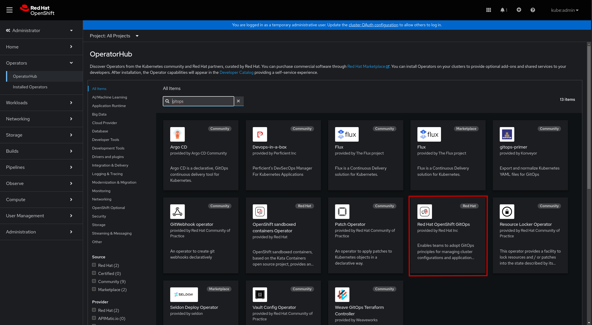
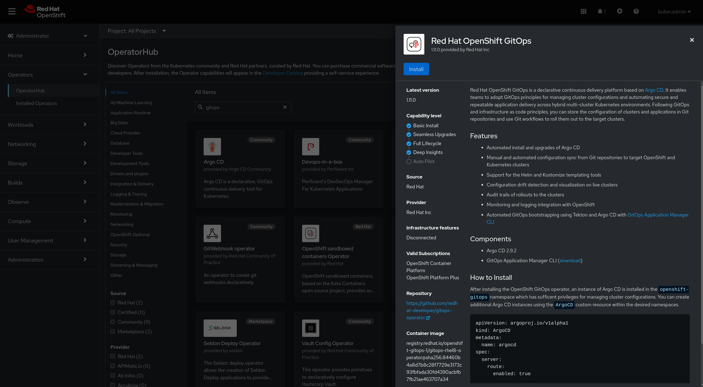
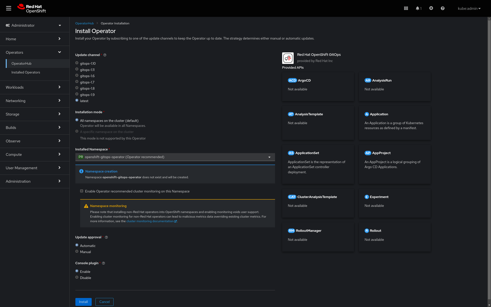
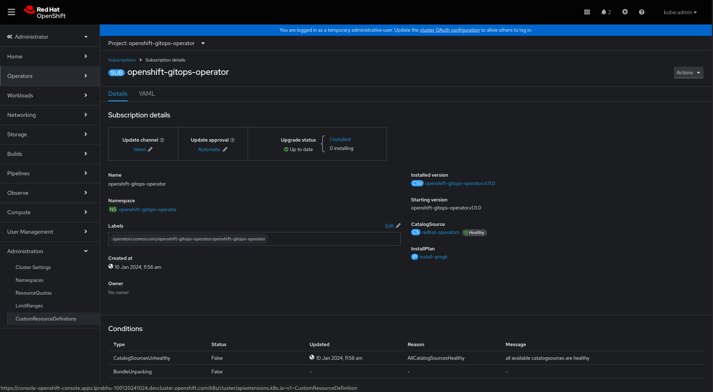
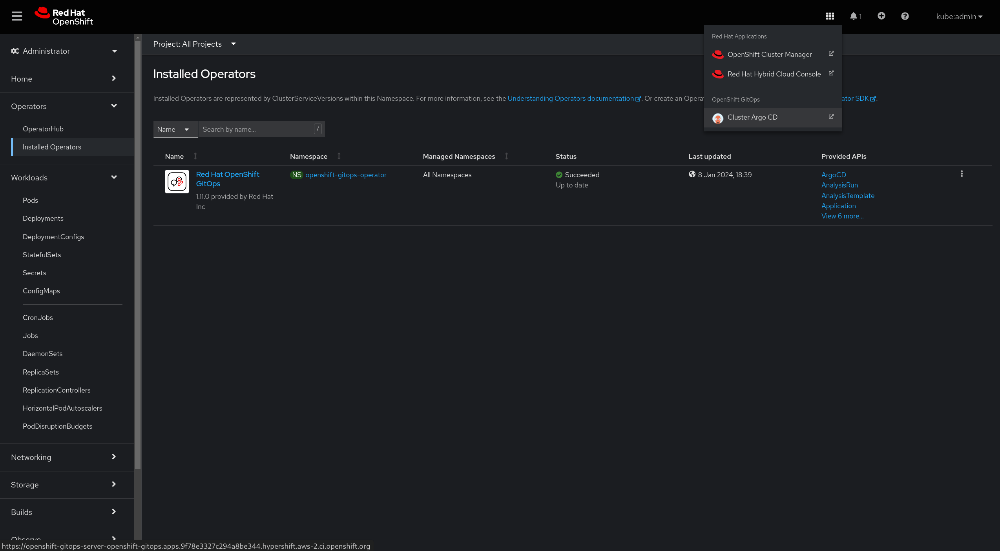
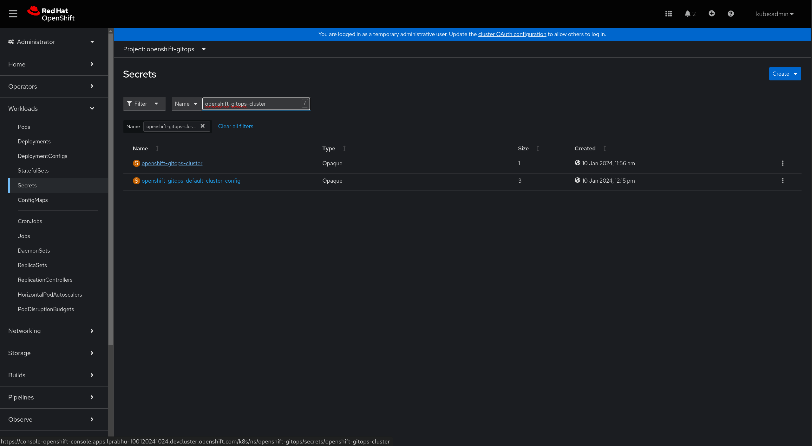
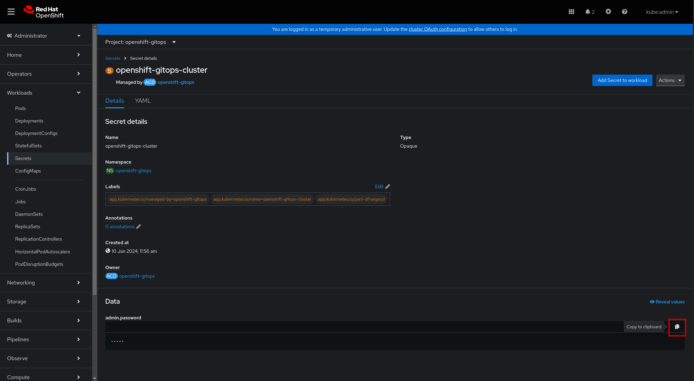
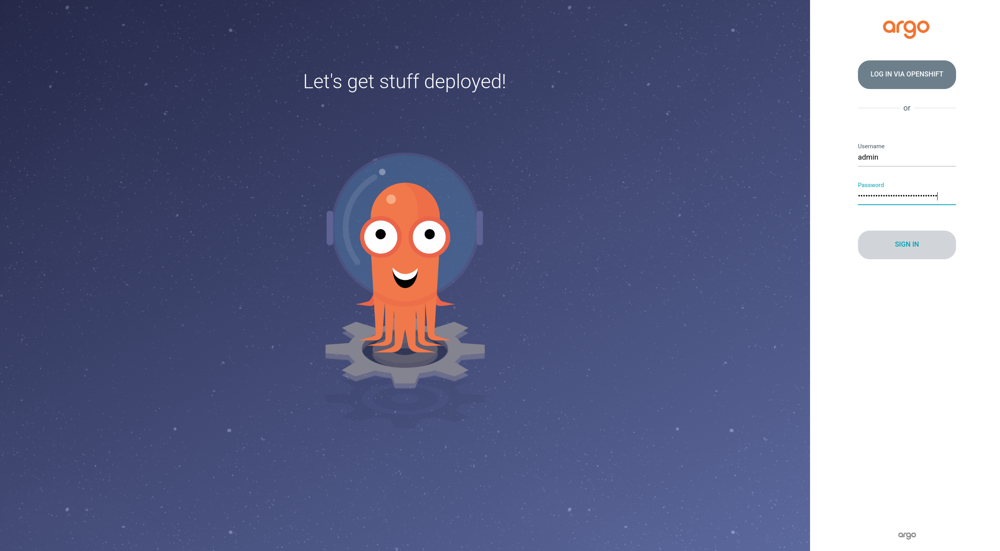

# Installing OpenShift GitOps

## Terminology

* **Update channel**: Choose the channel according to the required operator version. latest channel points to the latest released version.
    * **Note**: For installing a z stream release, upgrade the operator in the respective versioned channel (or in the latest accordingly)|
* **Installation mode**: As mentioned, the operator is only supported in default mode, retaining the value as is.
* **Installed Namespace**: openshift-operators namespace was the default installation namespace. Starting 1.10.0, we support installation in openshift-gitops-operator namespace as default. Choosing this namespace and enabling the Namespace monitoring option below, enables the monitoring. openshift-operators can also be used as the installation namespace but monitoring wouldn’t be possible with this namespace.
* **Update approval**: As the name suggests, with Automatic approval, updates are applied automatically, whereas with Manual approval, updates would require Manual intervention
* **Console plugin**: Enable/ Disable console plugin


## Operator Install GUI

To install OpenShift GitOps, find the OpenShift GitOps Operator in OperatorHub by typing "gitops" in the search box and click on the OpenShift GitOps Operator.



The Operator UI guides you through to install the OpenShift GitOps Operator.  You can go ahead with the default installation options (this operator installs to all namespaces on the cluster).



Click the "Install" button to finish the installation.



* * *


## Operator Install CLI

To install the Operator via the CLI, you will need to create a Subscription.

```yaml
apiVersion: operators.coreos.com/v1alpha1
kind: Subscription
metadata:
  name: openshift-gitops-operator
  namespace: <Installed namespace>
  labels:
    operators.coreos.com/openshift-gitops-operator.openshift-operators: ''
spec:
  channel: <Update channel>
  installPlanApproval: <Update approval>
  name: openshift-gitops-operator
  source: redhat-operators
  sourceNamespace: openshift-marketplace
  startingCSV: openshift-gitops-operator.v<version of the operator>
```


Then, you apply this to the cluster.

`$ oc apply -f openshift-gitops-sub.yaml`

#### Note: 
* startingCSV parameter in the subscription allows you to choose the required version
* If you want the Installed namespace to be openshift-gitops-operator
    * Create the namespace and the OperatorGroup before applying the subscription
    * You can enable cluster monitoring manually by adding the below mentioned label

```console
// Create the namespace
$ oc create ns openshift-gitops-operator

// Create the OperatorGroup
$ oc create -f - <<EOF
apiVersion: operators.coreos.com/v1
kind: OperatorGroup
metadata:
  name: openshift-gitops-operator
  namespace: openshift-gitops-operator
spec:
  upgradeStrategy: Default
EOF

// Enable cluster monitoring
$ oc label namespace openshift-gitops-operator openshift.io/cluster-monitoring=true
```

After a while (about 1-2 minutes), you should see the following Pods appear.

```console
$ oc get pods -n openshift-gitops 
NAME                                                         READY   STATUS    RESTARTS   AGE
cluster-65885cfb44-x6lx4                                     1/1     Running   0          55s
gitops-plugin-58b577c9c9-p78xl                               1/1     Running   0          55s
openshift-gitops-application-controller-0                    1/1     Running   0          52s
openshift-gitops-applicationset-controller-f66d47bc4-9rsd8   1/1     Running   0          52s
openshift-gitops-dex-server-55f8c6c44-s9jcl                  1/1     Running   0          51s
openshift-gitops-redis-75d88d67c8-jrvr5                      1/1     Running   0          52s
openshift-gitops-repo-server-77987b679-mr6ld                 1/1     Running   0          52s
openshift-gitops-server-86df579bbf-zz9lx                     1/1     Running   0          52s
```

## Installation of OpenShift GitOps without ready-to-use Argo CD instance, for ROSA/OSD

When installing the OpenShift GitOps operator to ROSA/OSD, cluster administrators may wish to exclude users from modifying resources within the *openshift-** namespaces, including the *openshift-gitops* namespace which is the default location for an Argo CD install.

To disable the default ‘ready-to-use’ installation of Argo CD: as an admin, update the existing Subscription Object for Gitops Operator and add `DISABLE_DEFAULT_ARGOCD_INSTANCE = true` to the spec.

**Warning**: setting this option to true will cause the existing Argo CD install in the *openshift-gitops* namespace to be deleted. Argo CD instances in other namespaces should not be affected.

   On OpenShift Console, go to *Administration* -> *CustomResourceDefinition* -> *Subscription* -> *Instances* and select `openshift-gitops-operator`.




Select the **YAML** tab and edit the Subscription

A ready-to-use Argo CD instance is created by GitOps Operator in the *openshift-gitops* namespace.   The instance name is also *openshift-gitops*.

## Logging in to the ready-to-use Argo CD


You can launch into this Argo CD instance from the Console Application Launcher.



**Note:** To disable the Link to Argo CD in the Console Application Launcher, see the documentation on how to disable consoleLink in the [setting environment variables section](#setting-environment-variables)

Alternatively, the DNS hostname of the Argo CD Web Console can be retrieved by the command line.  

`oc get route openshift-gitops-server -n openshift-gitops -o jsonpath='{.spec.host}'`


The output of the command (e.g. openshift-gitops-server-openshift-gitops.apps.gitops1.devcluster.openshift.com) can be pasted to the address bar of a web browser.   The web browser will open the login page of the Argo CD instance.

For the pre-created Argo CD instance under **_openshift-gitops_** project, you’ll find the password here:

* Navigate to the "openshift-gitops" project

* Go to "Secrets" tab and find the secret \<argocd-instance-name\>-cluster.   *openshift-gitops-cluster *in this case for the pre-created Argo CD instance.




* Copy the password to the clipboard




Alternatively, you may fetch the Argo CD instance’s  admin password running the command line.

`oc get secret/openshift-gitops-cluster -n openshift-gitops -o jsonpath='{.data.admin\.password}' | base64 -d`

And now you can log in to the Argo CD UI as *admin* using the retrieved password.



GitOps Operator comes with a bundled Dex instance which can be configured for authenticating with Argo CD component of Openshift GitOps. For logging in, click on **LOG IN VIA OPENSHIFT** and use the credentials for kubeadmin user when redirected to Openshift login page.

### Create an Argo CD Application

Now, you can create an Argo CD application and let Argo CD keep application resources live states in sync with the configuration in Git.   

[https://github.com/siamaksade/openshift-gitops-getting-started](https://github.com/siamaksade/openshift-gitops-getting-started)

## Setting environment variables

Updating the following environment variables in the existing Subscription Object for the GitOps Operator will allow you (as an admin) to change certain properties in your cluster:

<table>
  <tr>
    <td>Environment variable</td>
    <td>Default value</td>
    <td>Description</td>
  </tr>
  <tr>
    <td>ARGOCD_CLUSTER_CONFIG_NAMESPACES</td>
    <td>none</td>
    <td>When provided with a namespace, Argo CD is granted permissions to manage specific cluster-scoped resources which include
    platform operators, optional OLM operators, user management, etc. Argo CD is not granted cluster-admin.</td>
  </tr>
  <tr>
    <td>CONTROLLER_CLUSTER_ROLE</td>
    <td>none</td>
    <td>Administrators can configure a common cluster role for all the managed namespaces in role bindings for the Argo CD application controller with this environment variable. Note: If this environment variable contains custom roles, the Operator doesn't create the default admin role. Instead, it uses the existing custom role for all managed namespaces.</td>
  </tr>
  <tr>
    <td>DISABLE_DEFAULT_ARGOCD_CONSOLELINK</td>
    <td>false</td>
    <td>When set to `true`, will disable the ConsoleLink for Argo CD, which appears as the link to Argo CD in the Application Launcher. This can be beneficial to users of multi-tenant clusters who have multiple instances of Argo CD.</td>
  </tr>
  <tr>
    <td>DISABLE_DEFAULT_ARGOCD_INSTANCE</td>
    <td>false</td>
    <td>When set to `true`, will disable the default 'ready-to-use' installation of Argo CD in `openshift-gitops` namespace.</td>
  </tr>
  <tr>
    <td>SERVER_CLUSTER_ROLE</td>
    <td>none</td>
    <td>Administrators can configure a common cluster role for all the managed namespaces in role bindings for the Argo CD server with this environment variable. Note: If this environment variable contains custom roles, the Operator doesn’t create the default admin role. Instead, it uses the existing custom role for all managed namespaces.</td>
  </tr>
</table>
