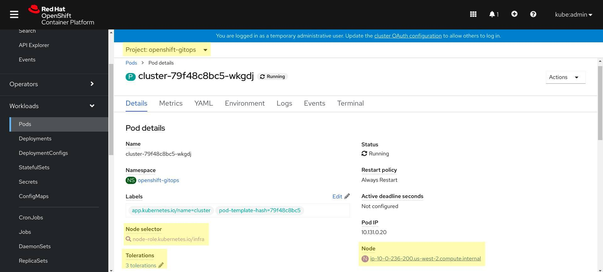
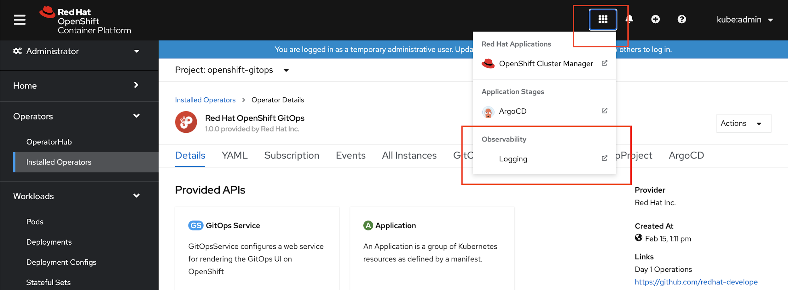
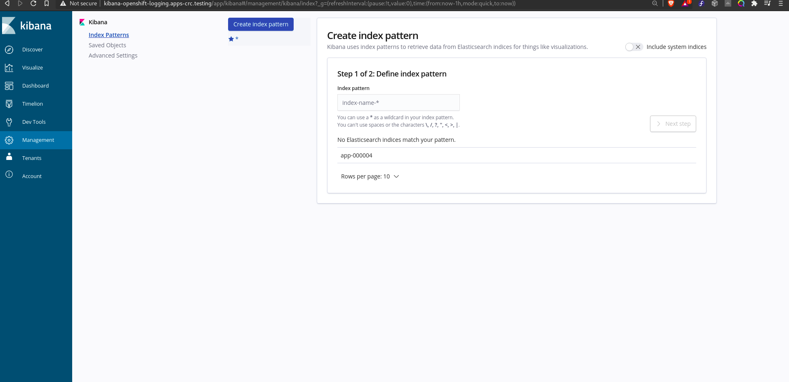
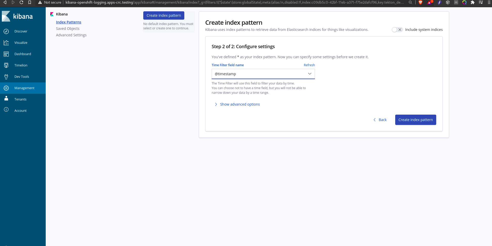
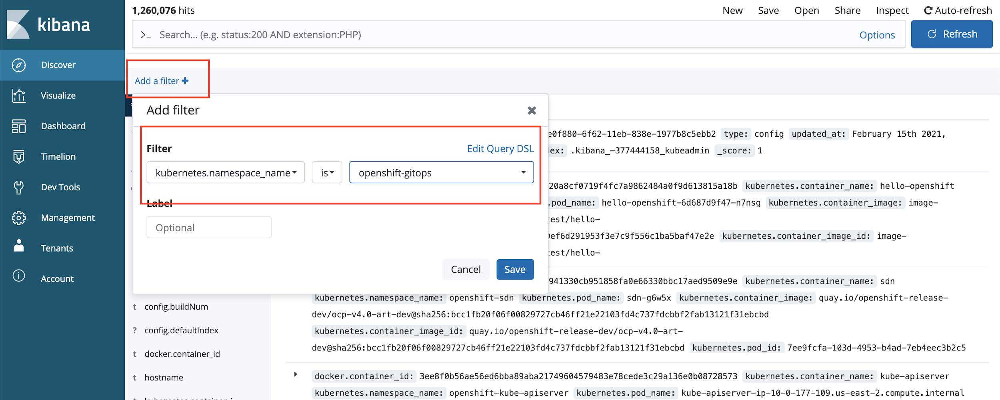
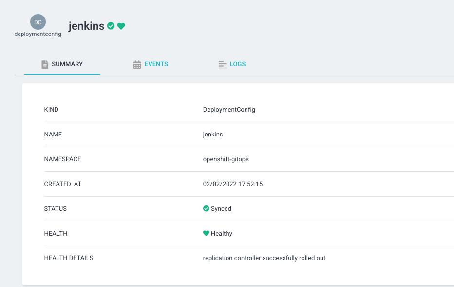

# Custom Tooling

See [upstream documentation](https://argo-cd.readthedocs.io/en/stable/operator-manual/custom_tools/) for more information

## Adding Tools Via Volume Mounts

Both init containers and volumes can be added to the repo server using the `ArgoCD` custom resource

```yaml
apiVersion: argoproj.io/v1alpha1
kind: ArgoCD
metadata:
  name: argocd-sample
spec:
  repo:
    # 1. Define an emptyDir volume which will hold the custom binaries
    volumes:
    - name: custom-tools
      emptyDir: {}
    # 2. Use an init container to download/copy custom binaries into the emptyDir
    initContainers:
    - name: download-tools
      image: alpine:3.8
      command: [sh, -c]
      args:
      - wget -qO- https://storage.googleapis.com/kubernetes-helm/helm-v2.12.3-linux-amd64.tar.gz | tar -xvzf - &&
        mv linux-amd64/helm /custom-tools/
      volumeMounts:
      - mountPath: /custom-tools
        name: custom-tools
    # 3. Volume mount the custom binary to the bin directory (overriding the existing version)
    volumeMounts:
    - mountPath: /usr/local/bin/helm
      name: custom-tools
      subPath: helm
```

## Configure resource quota/requests for OpenShift GitOps workloads

This section covers the steps to create, update and delete resource requests and limits for Argo CD workloads.

The Argo CD Custom Resource allows you to create the workloads with desired resource requests and limits. This is required when a user/admin wishes to deploy his Argo CD instance in a namespace that is set with [Resource Quota](https://kubernetes.io/docs/concepts/policy/resource-quotas/).

For example, the below Argo CD instance deploys the Argo CD workloads such as Application Controller, ApplicationSet Controller, Dex, Redis, Repo Server and Server with resource requests and limits. Similarly you can also create the other workloads with resource requirements.

**Note:** The resource requirements for the workloads in the below example are not the recommended values. Please do not consider them as defaults for your instance.

```
apiVersion: argoproj.io/v1beta1
kind: ArgoCD
metadata:
  name: example
spec:
  server:
    resources:
      limits:
        cpu: 500m
        memory: 256Mi
      requests:
        cpu: 125m
        memory: 128Mi
    route:
      enabled: true
  applicationSet:
    resources:
      limits:
        cpu: '2'
        memory: 1Gi
      requests:
        cpu: 250m
        memory: 512Mi
  repo:
    resources:
      limits:
        cpu: '1'
        memory: 512Mi
      requests:
        cpu: 250m
        memory: 256Mi
  sso:
    dex:
      resources:
        limits:
          cpu: 500m
          memory: 256Mi
        requests:
          cpu: 250m
          memory: 128Mi
  redis:
    resources:
      limits:
        cpu: 500m
        memory: 256Mi
      requests:
        cpu: 250m
        memory: 128Mi
  controller:
    resources:
      limits:
        cpu: '2'
        memory: 2Gi
      requests:
        cpu: 250m
        memory: 1Gi
```
## Running default Gitops workloads on Infrastructure Nodes

Infrastructure nodes prevent additional billing cost against subscription counts. 
OpenShift allows certain workloads installed by the OpenShift GitOps Operator to run on Infrastructure Nodes. This comprises the workloads that are installed by the GitOps Operator by default in the openshift-gitops namespace, including the default Argo CD instance in that namespace.
Note: Other Argo CD instances installed to user namespaces are not eligible to run on Infrastructure nodes.
	
Follow the steps to move these default workloads to infrastructure node
* cluster deployment (backend service)
* openshift-gitops-applicationset-controller deployment
* openshift-gitops-dex-server deployment
* openshift-gitops-redis deployment
* openshift-gitops-redis-ha-haproxy deployment
* openshift-gitops-repo-sever deployment
* openshift-gitops-server deployment
* openshift-gitops-application-controller statefulset
* openshift-gitops-redis-server statefulset
	
#### Adding label to existing nodes
	
* Please refer to official docs about infrastructure nodes -                                                   [https://access.redhat.com/solutions/5034771](https://access.redhat.com/solutions/5034771) [https://docs.openshift.com/container-platform/4.6/machine_management/creating-infrastructure-machinesets.html](https://docs.openshift.com/container-platform/4.6/machine_management/creating-infrastructure-machinesets.html) 

* Label your existing nodes as **Infrastructure** via cli or from openshift UI -  

`oc label node <node-name> node-role.kubernetes.io/infra=""`


* To isolate the workloads on Infra nodes and prevent other workloads to schedule on these nodes, **taints** can be applied on these nodes, for example a sample taint can be added from cli - 

`oc adm taint nodes -l node-role.kubernetes.io/infra infra=reserved:NoSchedule infra=reserved:NoExecute`

#### Add *runOnInfra* toggle in the GitopsService CR to add infra node selector

`oc edit gitopsservice -n openshift-gitops`

```
apiVersion: pipelines.openshift.io/v1alpha1
kind: GitopsService
metadata:
  name: cluster
spec:
  runOnInfra: true
```

#### Add *tolerations* to the GitopsService CR

If taints are added to your nodes you can add tolerations in the CR, sample toleration - 

`oc edit gitopsservice -n openshift-gitops`

```
apiVersion: pipelines.openshift.io/v1alpha1
kind: GitopsService
metadata:
  name: cluster
      spec:
  runOnInfra: true
  tolerations:
  - effect: NoSchedule
    key: infra
    value: reserved
  - effect: NoExecute
    key: infra
    value: reserved 
```

###### Verify that the workloads in  openshift-gitops  namespace are now scheduled on infrastructure nodes, if you click on any pod and see its details, you can see the nodeSelector and tolerations added.

Note - Any manually added nodeSelectors and tolerations in the default Argo CD CR will be overwritten by the toggle and tolerations in gitops service CR.

## Using NodeSelector and Tolerations in Default Instance of Openshift GitOps	

Users can set custom nodeSelectors and tolerations in their default workloads by editing their GitopsService CR like so:

```
kind: GitopsService
metadata:
  name: cluster	
spec:
  nodeSelector:
    key1: value1
  tolerations:
  - effect: NoSchedule
    key: key1
    value: value1 	
```
	
Note: The operator also has default nodeSelector for Linux, and runOnInfra toggle also sets Infrastructure nodeSelector in the workloads. All these nodeSelectors will be merged with precedence given to the custom nodeSelector in case the keys match.

## Using PriorityClass for Argo CD workloads

Set `spec.priorityClassName` on the ArgoCD CR so GitOps pods can stay scheduled when the cluster is under resource pressure. The Operator applies that class to all operator-managed component pods for that instance (application controller, repo-server, server, Redis, ApplicationSet, Dex, commit-server when source hydrator is enabled, and other enabled components).

`PriorityClass` is cluster-scoped and typically requires cluster-admin. See the Kubernetes docs on [Pod Priority and Preemption](https://kubernetes.io/docs/concepts/scheduling-eviction/pod-priority-preemption/).

Create a PriorityClass first. Leave `globalDefault: false` so only pods that name this class use it:

```yaml
apiVersion: scheduling.k8s.io/v1
kind: PriorityClass
metadata:
  name: gitops-high-priority
value: 1000000
globalDefault: false
preemptionPolicy: PreemptLowerPriority   # or Never — schedule ahead but never evict
description: Priority class for OpenShift GitOps workloads
```

```
oc apply -f priorityclass.yaml
```

Then set the field on the Argo CD instance (including the default instance in `openshift-gitops`):

```yaml
apiVersion: argoproj.io/v1beta1
kind: ArgoCD
metadata:
  name: example-argocd
spec:
  priorityClassName: gitops-high-priority
```

Changing or clearing the field updates the workloads on reconcile. This is configured on the ArgoCD CR, not on `GitopsService`. If the field is omitted, pods use the cluster default priority (typically 0).

## Managing MachineSets with OpenShift GitOps

Machinesets are resources that are created during an OpenShift cluster's installation and can be used to manipulate compute units or "machines" on said OpenShift cluster. They typically contain cluster specific information such as availability zones that are hard to predict, and randomly generated names that cannot be known beforehand. As such, machinesets are hard targets to manage in a GitOps way. However, users wanting to manage their machinests using Argo CD can still do so, with a little manual effort, by leveraging server-side apply.

Users can manually find out the resource names for the machinesets available on their clusters by running the command:
`oc get machinesets -n openshift-machine-api`

Users can then create a patch for this resouce by only expressing the name of the target machineset and the specific set of fields and values that they would like to modify and manage through Argo CD. For example:

```
apiVersion: machine.openshift.io/v1beta1
kind: MachineSet
metadata:
  name: rhoms-4-10-081004-6jgmc-worker-us-east-2a
spec:
  replicas: 3

```

Users can store the above described patch within their GitOps repositories to be applied and managed along with other Argo CD managed resources.

[Kubernetes Server Side Apply](https://kubernetes.io/docs/reference/using-api/server-side-apply/) allows users to patch existing resources and manage specific sets of fields only by setting the 'field manager' for those fields appropriately. Argo CD will soon include the ability to support server-side apply for manifests as described in this [accepted proposal](https://github.com/argoproj/argo-cd/blob/master/docs/proposals/server-side-apply.md#server-side-apply-support-for-argocd). Users will have the option to express that they would like to enforce server-side apply through a new sync option either at application level, or at individual resource level by leveraging appropriate annotations (more details [here](https://github.com/argoproj/argo-cd/blob/master/docs/proposals/server-side-apply.md#use-cases)).

On following these steps, users should be able to manage their machinesets using Argo CD v2.5 and upwards (available with OpenShift GitOps v1.7 and upwards). They should be able to have Argo CD apply their patches to existing resources using server-side apply, see the changes reflected on cluster, and have the 'field manager' updated appropriately for their resources. 


## Logging 

To store and retrieve logs, a user can choose to leverage the Logging Stack provided by OpenShift. It provides a better visualization of logs using Kibana Dashboard. To integrate Argo CD with OpenShift Logging stack, OpenShift Logging default options enable logging with Argo CD.  No additional configuration is required.

#### Navigating Argo CD logs using the Kibana Dashboard

As a prerequisite, OpenShift Logging with default options is installed

Steps:

* First, we need to open the Kibana Dashboard. Users can access the Kibana Dashboard by clicking **Logging** under the **Observability** tab. 



* If this is the first time the Kibana dashboard is launched, an index pattern needs to be created in Kibana. A simple `"*"` index will do for now.

Use **_@timestamp_** as Time Filter Field Name. 

* After the creation of the Index, select the **_Discover_**  tab on the left hand side. Provide filters to retrieve logs for Argo CD. 

Following filters can be created to retrieve logs for OOTB Argo CD instance in **openshift-gitops** namespace

* Under the search bar, click on "add a filter".

* Provide `kubernetes.namespace_name` as the filter with value `openshift-gitops`. This filter would retrieve logs for all the pods in "openshift-gitops" namespace.   

* To retrieve logs for particular pods, additional filters like **kubernetes.pod_name** can be added to the filter list.

* Once the filter is created, users can see the filtered logs on the dashboard. 

## Prevent auto-reboot during Argo CD sync with machine configs

Nodes in [Red Hat OpenShift](https://developers.redhat.com/openshift) can be updated automatically through OpenShift's Machine Config Operator (MCO). A machine config is a custom resource that helps a cluster manage the complete life cycle of its nodes. When a machine config resource is created or updated in a cluster, the MCO picks up the update, performs the necessary changes to the selected nodes, and restarts the nodes gracefully by cordoning, draining, and rebooting them. The MCO handles everything ranging from the kernel to the kubelet.

However, interactions between the MCO and the [GitOps workflow](https://developers.redhat.com/topics/gitops) can introduce major performance issues and other undesired behavior. This article shows how to make the MCO and the [Argo CD](https://argoproj.github.io/) GitOps orchestration tool work well together.

## **Machine configs and Argo CD: Performance challenges**

When using machine configs as part of a GitOps workflow, the following sequence can produce suboptimal performance:

1. Argo CD starts a [sync job](https://argo-cd.readthedocs.io/en/stable/user-guide/auto_sync/) after a commit to the Git repository containing application resources.

2. If Argo CD notices a new or changed machine config while the sync operation is ongoing, MCO picks up the change to the machine config and starts rebooting the nodes to apply it.

3. If any of the nodes that are rebooting contain the Argo CD application controller, the application controller terminates and the application sync is aborted.

Because the MCO reboots the nodes in sequential order, and the Argo CD workloads can be rescheduled on each reboot, it could take some time for the sync to be completed. This could also result in undefined behavior until the MCO has rebooted all nodes affected by the machine configs within the sync.

For more details and implementation, please refer to this [blog post](https://developers.redhat.com/articles/2021/12/20/prevent-auto-reboot-during-argo-cd-sync-machine-configs#). 

## Health status of OpenShift resources

This enhancement adds support to display the Health status of OpenShift resources like DeploymentConfig, routes and Operators that you install using OLM. This enables you to better monitor the overall health status of your application.

Create an Argo CD Application with the below details.




Sync the application and wait for the resources to be created. After a while you will notice that the deployment config resource is created. Click on the deployment config resource to get the health and status information.

 


