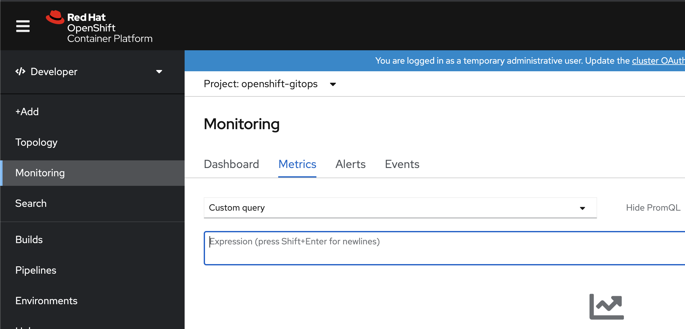
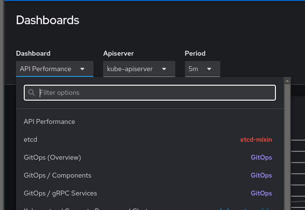

# Monitoring

OpenShift GitOps automatically detects Argo CD instances on the cluster and wires them up with the cluster monitoring stack. Instances in an `openshift-*` namespace need no extra configuration. Instances in other namespaces need user-workload monitoring: set `enableUserWorkload: true` in the `cluster-monitoring-config` ConfigMap in `openshift-monitoring`. Alerts appear under **Observe → Alerting**.

## Application alerts

By default, the Operator creates two `PrometheusRule` objects in the Argo CD instance namespace:

- `gitops-operator-argocd-alerts` — `ArgoCDSyncAlert` (warning): Application is OutOfSync for 5m (Git ≠ cluster).
- `gitops-operator-argocd-sync-loop-alerts` — `ArgoCDAppSyncLoop` and `ArgoCDAppSyncFailureLoop` (warning).

`ArgoCDSyncAlert` reports **drift**. Sync-loop alerts report **thrashing**: the Application keeps syncing and does not settle. An app can be OutOfSync for hours waiting on a human, or OutOfSync because it is syncing every minute forever. Only the second case trips the sync-loop alerts.

`spec.monitoring.disableMetrics: true` on the Argo CD CR removes the rules **and** stops all Argo CD metrics collection (ServiceMonitors, the Prometheus read role, and the namespace monitoring label), not just the alerts. To change or silence an individual alert, edit the `PrometheusRule` in place (see [Scope and tuning](#scope-and-tuning)).

## Sync-loop alerts

A separate `PrometheusRule` is used so upgrades install these alerts without changing the existing OutOfSync rule.

| Alert | Condition | `for` | What it means |
|-------|-----------|-------|----------------|
| `ArgoCDAppSyncLoop` | `gitops:argocd_app_sync:rate10m > 0.01` (~1 sync every ~100s) | 20m | Sustained high sync rate (any outcome) |
| `ArgoCDAppSyncFailureLoop` | `gitops:argocd_app_sync_failed:rate10m > 0.005` | 15m | Sustained Error/Failed sync rate |

Recording rules (same object):

```promql
gitops:argocd_app_sync:rate10m
  = sum by (name, namespace) (rate(argocd_app_sync_total{namespace="<argo-ns>"}[10m]))

gitops:argocd_app_sync_failed:rate10m
  = sum by (name, namespace) (rate(argocd_app_sync_total{namespace="<argo-ns>",phase=~"Error|Failed"}[10m]))
```

`<argo-ns>` is the Argo CD instance namespace (for example `openshift-gitops`).

### Interpreting the signal

| Firing | Typical pattern | Likely cause |
|--------|-----------------|--------------|
| `ArgoCDAppSyncLoop` only | Syncs **succeed**, app stays OutOfSync / Progressing | Controller conflict or admission defaulting (HPA vs Git `replicas`, mutating webhook, LimitRange, another operator) |
| `ArgoCDAppSyncFailureLoop` (with or without `ArgoCDAppSyncLoop`) | Syncs **Error/Failed**, auto-sync retries | Bad manifest, webhook reject, immutable field, missing permissions |
| `ArgoCDSyncAlert` only | Drift, little or no sync rate | Waiting on a manual sync / human action — not a loop |

Prometheus can tell failing loops from succeeding loops via the `phase` label. It cannot tell “HPA conflict” from “mutating webhook”; those share the same metric signature.

Impact: extra load on the application-controller, repo-server, and Kubernetes API; the app may never settle; other apps on the same instance can starve under heavy load.

### Recommended operator actions

1. Identify the Application from the alert labels (`name` is the Application; `namespace` is the Argo CD instance namespace).
2. Inspect sync / operation status:

   ```console
   $ oc get application <name> -n <namespace> -o yaml
   $ oc get application <name> -n <namespace> -o jsonpath='{.status.operationState}{"\n"}'
   ```

3. Check Diff in the Argo CD UI or CLI for fields that keep changing.
4. Look for conflicting controllers on the same resources (HPA, other operators, mutating webhooks, LimitRanges):

   ```console
   $ oc get hpa -A
   $ oc get mutatingwebhookconfiguration
   ```

5. Confirm the metric rate in Observe → Metrics:

   ```promql
   gitops:argocd_app_sync:rate10m{name="<name>",namespace="<namespace>"}
   gitops:argocd_app_sync_failed:rate10m{name="<name>",namespace="<namespace>"}
   ```

   Application `status.history` length is a poor loop detector: re-applying the same revision often does not grow history. Use `argocd_app_sync_total`.

Then mitigate:

- Temporarily disable `selfHeal` / automated sync while you fix the conflict.
- Fix failing manifests, RBAC, or webhook policies if `ArgoCDAppSyncFailureLoop` is firing.

Known anti-pattern: Git wants `replicas: 1`, HPA sets `minReplicas: 3`, Application has `automated.selfHeal: true`. Syncs succeed, the app stays OutOfSync, and `ArgoCDAppSyncLoop` fires. Remove `replicas` from Git, or ignore that JSON pointer on the Application CR:

```yaml
# Argo CD Application CR
spec:
  ignoreDifferences:
    - group: apps
      kind: Deployment
      jsonPointers:
        - /spec/replicas
```

### False positives

Short bursts should not fire. The alert only fires if the rate stays above the threshold for the full duration (`ArgoCDAppSyncLoop` 20m, `ArgoCDAppSyncFailureLoop` 15m):

| Scenario | Why it looks busy | Why it should not fire |
|----------|-------------------|------------------------|
| Rapid legitimate commits | Many syncs in a few minutes | Burst ends inside 20m |
| ApplicationSet creates many apps | Spike in sync activity | Rate is **per Application**; one initial sync is tiny |
| Cluster upgrade / node churn | Temporary re-sync | Usually settles before the duration elapses |
| One `kubectl edit` + selfHeal | Single corrective sync | Does not last 20m |

### Scope and tuning

- Rules are scoped with `namespace="<Argo CD instance namespace>"`, the same pattern as `ArgoCDSyncAlert`. Application CRs that live **only** in other namespaces (apps-in-any-namespace) are not included.
- The Operator creates the `PrometheusRule` if it is absent and does not overwrite user edits. Delete the rule to recreate Operator defaults:

  ```console
  $ oc delete prometheusrule gitops-operator-argocd-sync-loop-alerts -n <argo-ns>
  ```

- To change thresholds, edit `gitops-operator-argocd-sync-loop-alerts` in place; the Operator will not revert your changes. Adding a separate `PrometheusRule` with the same alert name does not override the shipped one; both will fire. The Operator does not expose tunables on the Argo CD CR.

A failing loop with a high enough total rate can fire both `ArgoCDAppSyncFailureLoop` and `ArgoCDAppSyncLoop`. The Operator does not manage Alertmanager. If you want a single notification, inhibit the `ArgoCDAppSyncFailureLoop` warning when the failure alert is already firing for the same Application (`name` and `namespace`).

## Querying Argo CD metrics

Note that the metrics provided are for the Argo CD instance itself, and don’t include metrics provided by the applications.

To run simple queries against the Argo CD metrics, you can go to the metrics page of the Developer Console, select the namespace that Argo CD was installed into, select the Metrics tab, and enter a PromQL query in the custom queries field, for example

<table>
  <tr>
    <td>sum(argocd_app_info{dest_namespace=~"default",health_status!=""}) by (health_status)</td>
  </tr>
</table>




To take full advantage of the metrics provided by Argo CD, you can install Grafana to help analyze and visualize the metrics.  This [blog post](https://www.redhat.com/en/blog/custom-grafana-dashboards-red-hat-openshift-container-platform-4) walks you through deploying a custom Grafana instance to your cluster using the community provided Grafana operator.  *Note that community Operators are operators which have not been vetted or verified by Red Hat. Community Operators should be used with caution because their stability is unknown. Red Hat provides no support for Community Operators.*

The Argo CD project provides a sample Grafana dashboard [here](https://github.com/argoproj/argo-cd/blob/master/examples/dashboard.json) which can be imported into installed Grafana instance.

## GitOps Monitoring Dashboards 

As of GitOps Operator will deploy monitoring dashboards in the console Admin perspective. When navigating to *Observe* → *Monitoring* in the console, users should see four GitOps dashboards in the dropdown dashboard list: GitOps Overview, GitOps Components, GitOps gRPC and Rollouts. These dashboards are based on the upstream Argo CD dashboards but have been modified to work with OpenShift console. 



**Note: At this time disabling or changing the content of the dashboards is not supported.**
